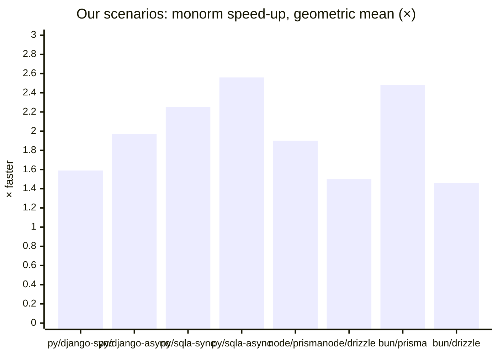

# Benchmark results

The verdict of each benchmark, from its latest run.
Every number is **measured** on the machine its detail file names.
Each section links to the detail: per-case tables, method, machine and raw data.
Older runs are not kept; `git log -- bench/` finds them.
How to run each benchmark: [`RUNNING.md`](RUNNING.md).

| Benchmark | Scenarios | Latest run (date, `main` commit, machine) | Results |
|---|---|---|---|
| [Our scenarios](#speed-up-summary) | 20 cases of our own, Python and TypeScript, against Django, SQLAlchemy, Prisma, Drizzle and `pg` | 2026-10-28, `d428e01`, cloud VM | [`summary.md`](compare/results/2026-10-28-d428e01/summary.md) |
| [IMDBench scenarios](#imdbench-scenarios) | The 3 IMDBench queries, Python and Node, against Django, SQLAlchemy, TypeORM, Prisma and the raw drivers | 2026-10-30, `5e1379d` (MonOrm 0.1.1), cloud VM | [`results.md`](imdbench/results/2026-10-30-5e1379d/results.md) |
| [Where a call spends its time](#where-a-call-spends-its-time) | 6 cases through 3 call paths, Python and Node, PostgreSQL and SQLite | 2026-10-30, `6332db55`, cloud VM | [`2026-10-30-report.md`](internal/results/2026-10-30-report.md) |
| [Rust engine only](#rust-engine-only) | 5 cases and 9 read paths, against SeaORM, Diesel and raw SQLx | 2026-10-03, `7b7538e` (inferred), macOS arm64 | [`results.md`](rust-compare/results/2026-10-03-7b7538e/results.md) |

## Speed-up summary

Our own 20 cases ([`compare/`](compare/README.md)), end to end with the database round trip.
Speed-up is contender time / `monorm` time: `2.3×` means `monorm` is 2.3 times faster.
Geometric mean over the cases; the range names the slowest and fastest case.

| `monorm` on | vs | Geometric mean | Range | Cases |
|---|---|---:|---|---:|
| Python | `django-sync` | 1.59× | 1.03× (tx-5) to 3.36× (concurrent) | 20 |
| Python | `django-async` | 1.97× | 1.10× (tx-5) to 3.55× (m2m) | 20 |
| Python | `sqlalchemy-sync` | 2.25× | 0.92×, slower (tx-5) to 11.57× (bulk-insert-1000) | 20 |
| Python | `sqlalchemy-async` | 2.56× | 1.19× (tx-5) to 13.23× (bulk-insert-1000) | 20 |
| Node | `prisma` | 1.90× | 1.03× (delete-100) to 11.68× (upsert-100) | 20 |
| Node | `drizzle` | 1.50× | 0.97×, slower (tx-5) to 3.95× (m2m) | 20 |
| Bun | `prisma` | 2.48× | 1.61× (read-1000) to 3.61× (bulk-insert-1000) | 3 |
| Bun | `drizzle` | 1.46× | 1.24× (read-1000) to 1.63× (bulk-insert-1000) | 3 |

- `monorm` is faster on average than every ORM contender; it is slower only on `tx-5`, against `sqlalchemy-sync` and `drizzle`, by 8% and 3%.
- Without the database (query build plus SQL, approximate), Python `monorm` is 4.1× Django and 10.2× SQLAlchemy, and Node `monorm` is 2.4× Drizzle.
- The build with every extension (`monorm-all`) costs no measurable time in most cases: its interval includes 1.00×.
- The machine is a shared cloud VM (1-minute load 1.14 to 1.97): read a speed-up whose interval includes 1.00× as no difference.

## IMDBench scenarios

The upstream [IMDBench](https://github.com/geldata/imdbench) queries, run by us on one VM ([`imdbench/`](imdbench/RUNNING.md)), requests/s, geometric mean of 3 queries.

| Language | MonOrm | vs ORMs | Raw driver (floor) |
|---|---:|---|---|
| Python | 282.5 | 1.41× SQLAlchemy (199.8), 2.85× Django (99.1) | `asyncpg` 1,083.3: 3.8× MonOrm |
| Node | 383.0 | 1.65× Prisma (232.5), 2.18× TypeORM (175.6) | `pg` 431.0: 1.13× MonOrm |

MonOrm leads every ORM on every query, except Python `get_user`, where it ties SQLAlchemy inside the run spread.

## Where a call spends its time

[`internal/`](internal/README.md) splits one MonOrm call into layers.

- Building model instances (hop + instances) is the largest MonOrm layer everywhere: 770–1,475 µs for 1,000 rows on PostgreSQL.
- The Python query builder is next: a fifth to a third of a primary-key get.
- Value binding is small; the engine layer cannot be read on PostgreSQL (the Rust driver is faster than `psycopg` and `pg`).

## Rust engine only

[`rust-compare/`](rust-compare/README.md), with matched pool checkout settings.

- Our engine is faster than SeaORM in all 5 cases (about 1.5× on a primary-key get).
- Diesel async is faster for 1,000-row reads (263 vs 303 µs); a streamed-rows prototype closes that gap (248 µs).
