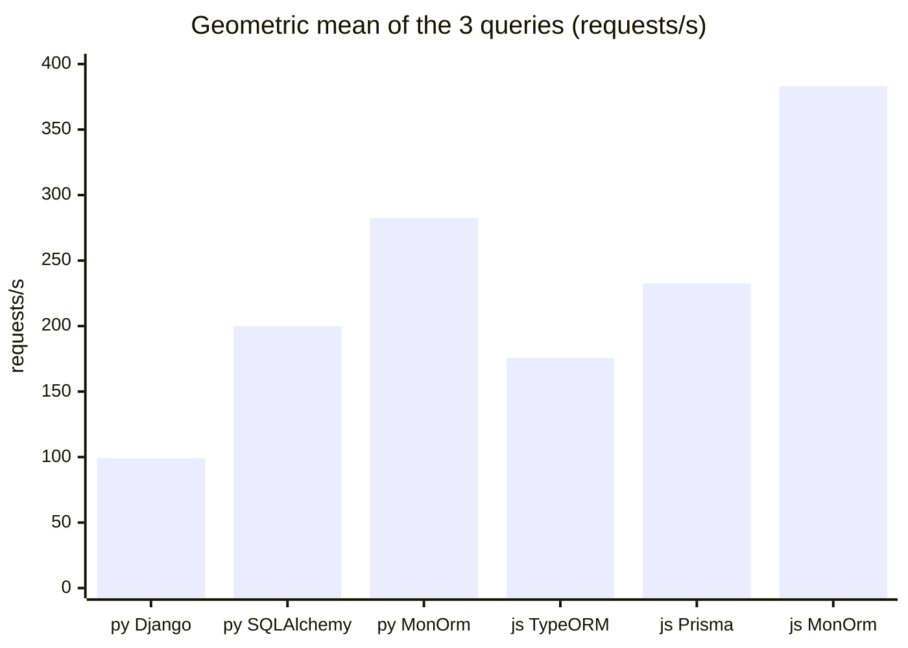
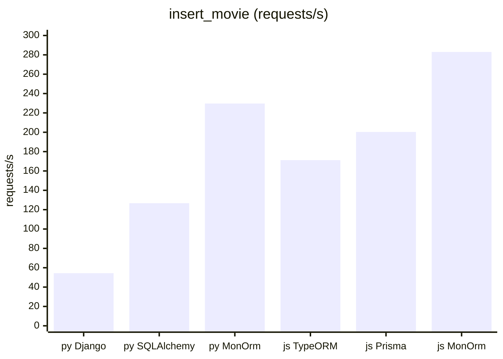
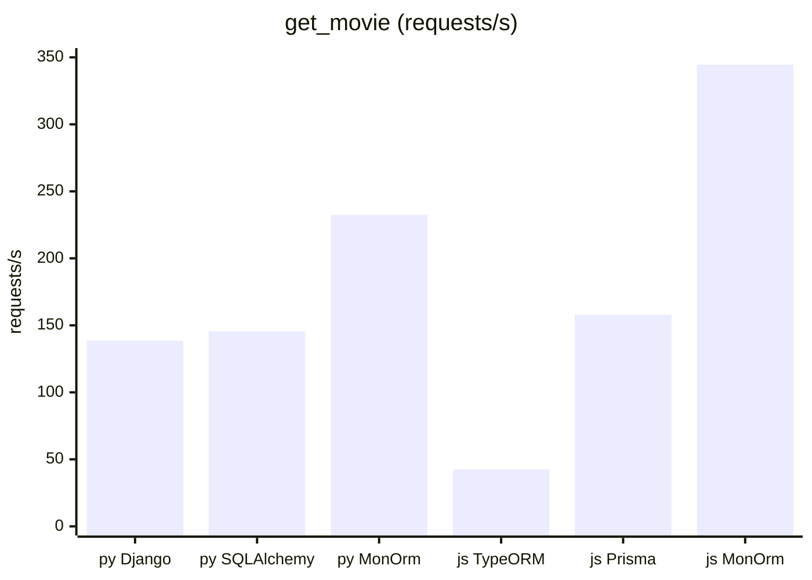
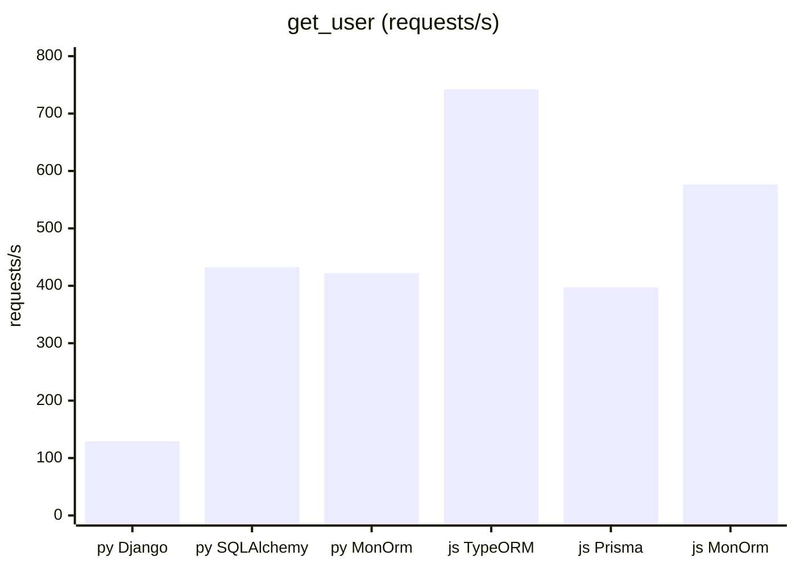

# IMDBench scenarios, 2026-10-30

The three IMDBench queries, run with MonOrm 0.1.1 (Python and Node) and the reference ORMs of each language.
Every number is **measured** on one VM (see [Machine](#machine)), in one session, on one shared database server.
Upstream 2023 numbers from another machine are not in this file: compare only the rows below.

## Verdict

- **Python:** MonOrm is 1.41× SQLAlchemy and 2.85× Django (geometric mean of requests/s); the raw `asyncpg` driver is 3.8× MonOrm.
- **Node:** MonOrm is 1.65× Prisma and 2.18× TypeORM; the raw `pg` driver is 1.13× MonOrm.
- MonOrm leads every ORM on every query, except `get_user` in Python, where MonOrm (422) and SQLAlchemy (432) are inside the run spread.

## Requests per second (higher is better)

The raw drivers are not in the charts: they are the floor, in the table below.
`py` is Python asyncio, `js` is Node.js.

## All contenders

Requests/s, then p50 / p99 latency in ms, of the median run (by requests/s) of 3.
The last column is the spread of requests/s over the 3 runs: (max − min) / median.

| Language | Contender | `insert_movie` | `get_movie` | `get_user` | Geometric mean | Largest spread |
|---|---|---|---|---|---|---:|
| Python | Django 4.2.30 | 54.4 (17.4 / 31.9) | 138.6 (6.7 / 13.8) | 129.0 (7.2 / 17.1) | 99.1 (9.5 / 19.6) | 11.6% |
| Python | SQLAlchemy 2.0.55 | 126.7 (7.1 / 16.6) | 145.5 (6.3 / 15.5) | 432.4 (2.1 / 5.4) | 199.8 (4.6 / 11.2) | 16.8% |
| Python | **MonOrm 0.1.1** | **229.7** (4.0 / 10.2) | **232.5** (4.0 / 9.9) | **422.2** (2.1 / 5.8) | **282.5** (3.2 / 8.3) | 20.4% |
| Python | raw `asyncpg` 0.32.0 (floor) | 1048.6 (0.9 / 2.9) | 896.1 (1.0 / 3.3) | 1352.9 (0.7 / 2.3) | 1083.3 (0.8 / 2.8) | 17.8% |
| Node | TypeORM 0.3.16 | 171.2 (5.2 / 13.1) | 42.6 (22.0 / 57.7) | 742.1 (1.2 / 4.4) | 175.6 (5.1 / 14.9) | 25.9% |
| Node | Prisma 5.6.0 | 200.3 (4.8 / 9.0) | 157.9 (6.0 / 12.2) | 397.5 (2.3 / 6.4) | 232.5 (4.0 / 8.9) | 28.6% |
| Node | **MonOrm 0.1.1** | **283.0** (3.3 / 8.0) | **344.5** (2.7 / 6.6) | **576.2** (1.6 / 4.8) | **383.0** (2.4 / 6.4) | 13.5% |
| Node | raw `pg` 8.11.0 (floor) | 291.8 (3.1 / 8.7) | 284.8 (3.3 / 8.6) | 963.5 (0.9 / 3.2) | 431.0 (2.1 / 6.2) | 20.1% |

The geometric mean row uses `bench.py`'s `mean_latency_stats` over the three median-run rows.
Per-run values: `raw/<language>-<run>.json`; console output: `raw/*.log`; start times and load: `raw/runs.log`.

## Read the numbers with care

- **Noise.** 16 of the 24 query/contender pairs have a spread above 10%. The VM is a 4-vCPU KVM guest; the noise hits every contender.
- **Extra query.** MonOrm has no `avg()` in `load()`, so `get_user` and `get_movie` run one extra `select()` for the average rating.
- **Id sampling.** The MonOrm contender samples ids in Python or JS, not with SQL `random()`. This is setup, not timed.
- **No network delay.** `--net-latency 1` was passed, but the kernel has no `netem`, and `bench.py` only records the value. No delay was applied.
- **Prisma setup.** The upstream `_prisma` setup for `insert_movie` uses MySQL `DELETE … JOIN` syntax. Only that untimed step was changed to PostgreSQL syntax.
- **Result check.** `_monorm/tools/check_results.py` printed `RESULT: PASS` for all 7 queries before the timed runs, after a fix to the check itself (it picked people whose id order differed per table).

## Method

IMDBench (`geldata/imdbench` at `88e5eb6`) with [`../../monorm.patch`](../../monorm.patch), upstream dataset of default size (100,000 people and users, 500,000 reviews, 25,000 movies; synth 0.6.9).
Settings of the upstream published run: `--concurrency 1 --duration 10 --net-latency 1`, queries `insert_movie`, `get_movie`, `get_user`.
Each language group ran 3 times, Python and JS alternating; the 1-minute load was under 1 before each run.
MonOrm came from PyPI (`monorm` 0.1.1) and npm (`@ufstack/monorm` 0.1.1), built from tag `v0.1.1` (`fc88505f`).
`main` was at `5e1379d` during the run.

## Machine

| | |
|---|---|
| CPU | Intel Xeon @ 2.80GHz, 4 vCPUs (KVM guest) |
| RAM | 15 GiB, no swap |
| OS | Ubuntu 24.04.5 LTS, Linux 6.18.44 x86_64 |
| PostgreSQL | server 14.24 (Docker `postgres:14`, as in the upstream `Makefile`) |
| Python | 3.13.17 |
| Node.js | 22.22.0 |

The database server, the clients and Docker ran on this VM; nothing else ran during the timed runs.
